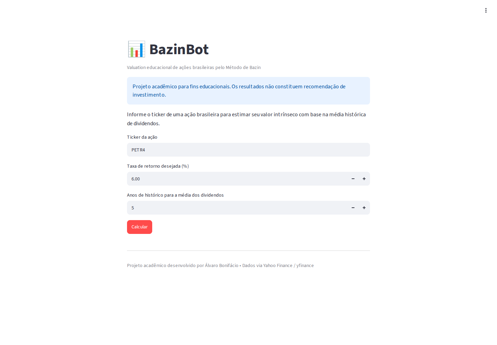
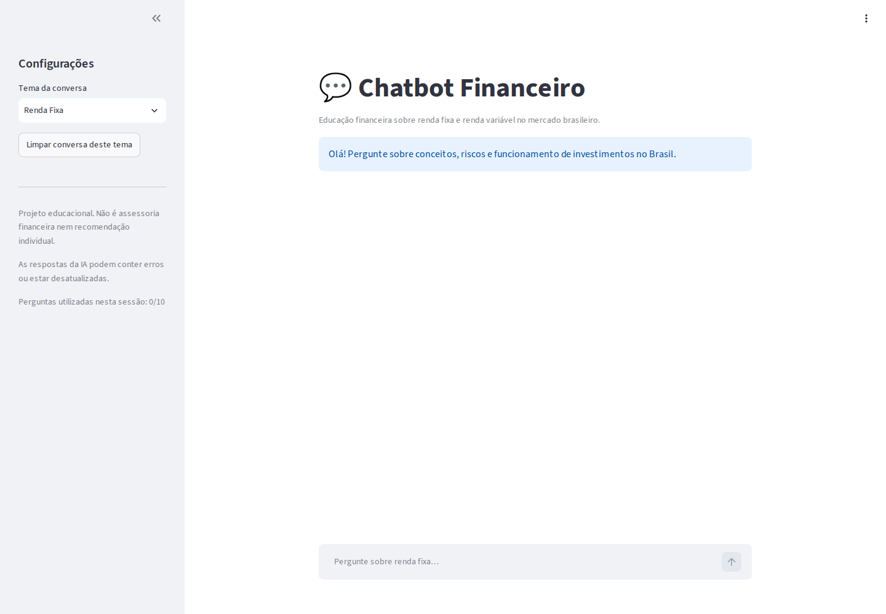
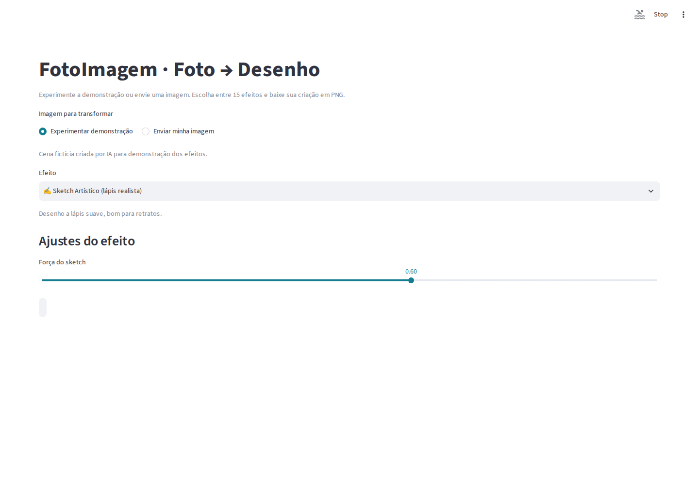

# Álvaro Bonifácio

**Tecnologia da Informação · Ciência de Dados · Inteligência Artificial · Gestão de TI**

Profissional de Tecnologia da Informação com **mais de 30 anos de experiência** em desenvolvimento de sistemas, gestão de serviços, projetos, processos e equipes. Atualmente, concentro meus estudos e projetos em **Ciência de Dados, Machine Learning e IA aplicada**, combinando experiência técnica e gerencial com investigação quantitativa e desenvolvimento de aplicações.

🎓 **Mestrando em Ciência da Computação — UFJF**, com interesse de pesquisa em Inteligência Computacional, modelagem preditiva e séries temporais financeiras. Desenvolvo também iniciativas independentes no **[CDMF-Lab](https://www.cdmf.ia.br)**, conectando dados, tecnologia e mercado financeiro.

## Projetos em destaque

Os projetos abaixo combinam aplicações que podem ser utilizadas no navegador com estudos técnicos e acadêmicos documentados.

### Aplicações web

| Projeto | O que demonstra | Acesso |
| :--- | :--- | :--- |
| **[BazinBot](https://github.com/alvarobonifacio1980/BazinBot)** | Coleta e tratamento de dados financeiros, cálculo educacional de valuation pelo Método de Bazin e interface Streamlit. | [Experimentar aplicativo](https://bazinbot.onrender.com/) |
| **[Chatbot Financeiro](https://github.com/alvarobonifacio1980/chatbot)** | Integração de IA generativa via API OpenAI, engenharia de prompts, histórico por sessão e interface conversacional de educação financeira. | [Experimentar chatbot](https://chatbot-financeiro-9p1s.onrender.com/) |
| **[FotoImagem](https://github.com/alvarobonifacio1980/foto_imagem)** | Processamento de fotografias com Python e OpenCV, diferentes efeitos visuais e aplicação web interativa. | [Experimentar aplicativo](https://fotoimagem.onrender.com/) |

### Aplicativos em funcionamento

Capturas reais das interfaces publicadas no Render, obtidas automaticamente pelo navegador:

| BazinBot | Chatbot Financeiro | FotoImagem |
| :---: | :---: | :---: |
|  |  |  |

> As demonstrações estão hospedadas no Render; no plano gratuito, o primeiro acesso após inatividade pode demorar. O chatbot utiliza IA generativa e suas respostas não constituem recomendação de investimento.

### Ciência de Dados e pesquisa aplicada

| Projeto | O que demonstra | Repositório |
| :--- | :--- | :--- |
| **Aprendizado de Máquina** | Estudos de previsão de volatilidade financeira, baselines, preparação de séries temporais e validação metodológica. | [Ver notebooks e documentação](https://github.com/alvarobonifacio1980/Aprendizado-de-Maquina) |
| **Mineração de Dados** | Preparação de dados e EDA, agrupamento, regras de associação, classificação e regressão. | [Ver notebooks e dados](https://github.com/alvarobonifacio1980/Mineracao-de-Dados) |
| **Análise de Dados** | ETL e análise exploratória com Python, estudos de séries financeiras e dashboards em Power BI e Tableau (vendas, estratégias, indicadores públicos e saúde). | [Ver projetos](https://github.com/alvarobonifacio1980/Analise-de-Dados) |

**Pesquisa em andamento:** previsão da volatilidade futura de ativos brasileiros, com atenção especial à PETR4. Os experimentos investigam séries temporais, indicadores financeiros, modelos estatísticos e de aprendizado de máquina, respeitando separação temporal entre treino e teste e prevenção de *data leakage*. Resultados experimentais não são promessas de desempenho em operações financeiras.

## Competências e ferramentas

| Área | Conhecimentos e tecnologias |
| :--- | :--- |
| **Dados e IA** | Python, Pandas, NumPy, Scikit-learn, estatística aplicada, Machine Learning, séries temporais e métodos de Deep Learning |
| **Análise e visualização** | SQL, Power BI, Tableau, análise exploratória, ETL, dashboards e indicadores de negócio |
| **Desenvolvimento** | Git, GitHub, Streamlit, OpenCV, APIs e aplicações com IA generativa |
| **Gestão de TI** | ITSM, ITIL, gestão de serviços e projetos, SLAs/ANS, BPMN, indicadores, observabilidade e melhoria contínua |

## Abordagem de trabalho

Busco soluções **simples, úteis, verificáveis e bem documentadas**. Em projetos analíticos, priorizo qualidade dos dados, reprodutibilidade, baselines adequados, validação temporal e interpretação cuidadosa dos resultados. Na gestão, valorizo a conexão entre processos, tecnologia e objetivos de negócio.

## Formação

- **Mestrado em Ciência da Computação — UFJF** *(em andamento)*
- **Pós-graduação em Ciência de Dados**
- **Pós-graduação em Gestão de Serviços de TIC**
- **Pós-graduação em Banco de Dados**
- **Formação superior em Gestão de Tecnologia da Informação**

## Contato e projetos

- 🌐 **[CDMF-Lab](https://www.cdmf.ia.br)** — pesquisa aplicada, soluções analíticas e conteúdos sobre tecnologia e mercado financeiro
- 💻 **[GitHub](https://github.com/alvarobonifacio1980?tab=repositories)** — repositórios e documentação técnica

---

*Projetos acadêmicos, educacionais e de pesquisa aplicada. Aplicações financeiras não constituem recomendação de investimento.*
