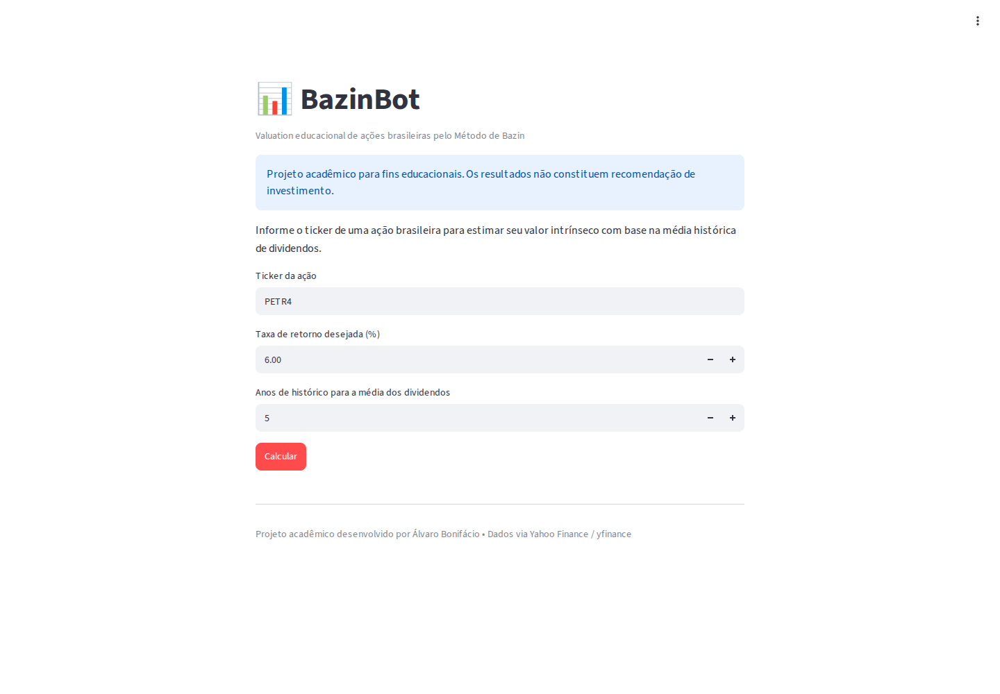
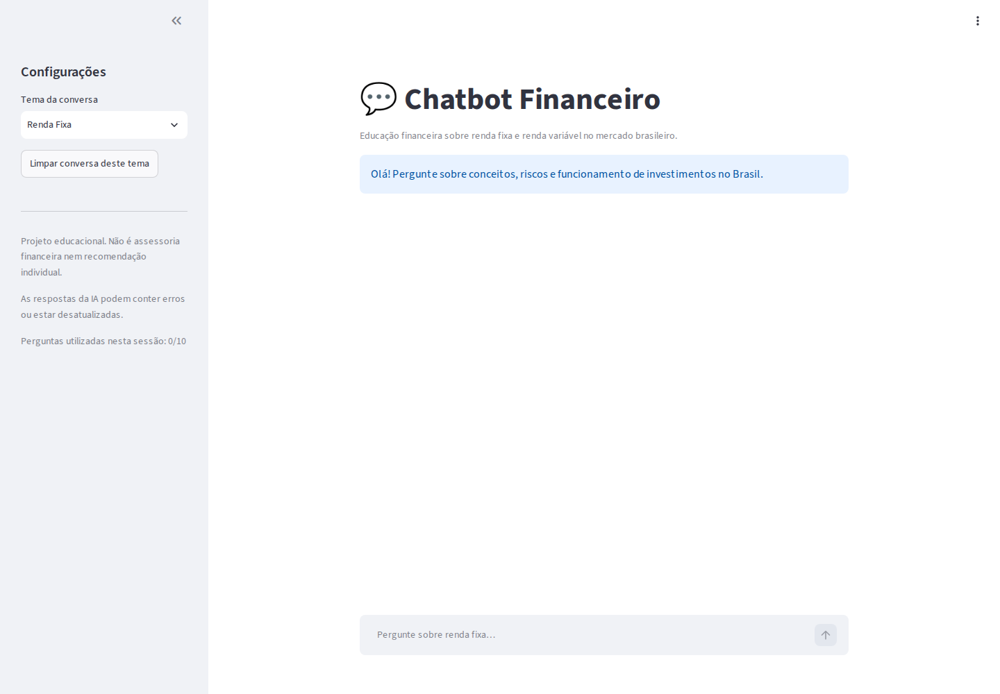
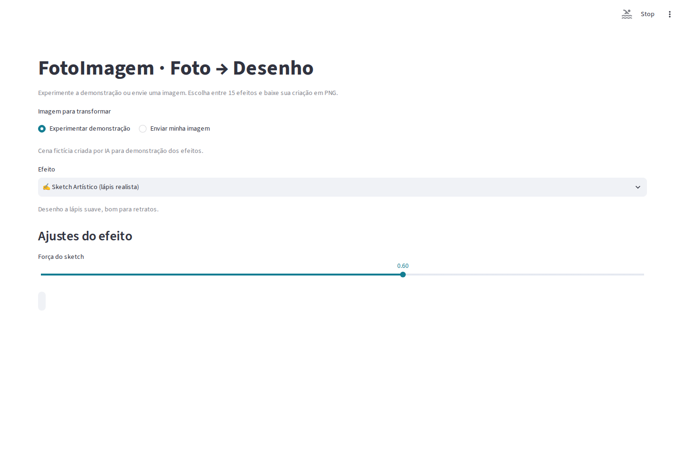

# Álvaro Bonifácio

**Análise e Ciência de Dados · Python · SQL · Power BI · Machine Learning**  
**Gestão de TI, Projetos e Serviços · ITSM · Governança**

Profissional de Tecnologia da Informação com atuação **desde 1997**, combinando experiência em desenvolvimento de sistemas, gestão de serviços e projetos multidisciplinares com estudos e aplicações em **Dados, Analytics e Inteligência Artificial**. Neste portfólio, reúno **dashboards, análises de dados, projetos de Machine Learning, SQL aplicado e aplicações web em Python e IA**.

🎓 **Mestrando em Ciência da Computação na UFJF**, com pesquisas em Inteligência Computacional e séries temporais. Desenvolvo também projetos independentes no **[CDMF-Lab](https://www.cdmf.ia.br)**.

## Comece por aqui

| Seu interesse | Projetos e exemplos |
| :--- | :--- |
| **Análise de Dados, BI e SQL** | [ETL, dashboards Power BI/Tableau e SQL aplicado à gestão de serviços](https://github.com/alvarobonifacio1980/Analise-de-Dados) |
| **Machine Learning e Deep Learning** | [Comparações entre modelos, LSTM, GRU, TCN, Transformer e ensembles](https://github.com/alvarobonifacio1980/Aprendizado-de-Maquina) |
| **Mineração de Dados** | [Agrupamento, associação, classificação e regressão](https://github.com/alvarobonifacio1980/Mineracao-de-Dados) |
| **Aplicações em Python e IA** | [BazinBot](https://github.com/alvarobonifacio1980/BazinBot) · [Chatbot](https://github.com/alvarobonifacio1980/chatbot) · [FotoImagem](https://github.com/alvarobonifacio1980/foto_imagem) |

## Projetos em destaque

Projetos de tecnologia e dados, incluindo aplicativos interativos e estudos aplicados.

### Aplicações web

| Projeto | O que demonstra | Acesso |
| :--- | :--- | :--- |
| **[BazinBot](https://github.com/alvarobonifacio1980/BazinBot)** | Coleta e tratamento de dados financeiros, cálculo educacional de valuation pelo Método de Bazin e interface Streamlit. | [Experimentar aplicativo](https://bazinbot.onrender.com/) |
| **[Chatbot Financeiro](https://github.com/alvarobonifacio1980/chatbot)** | Integração de IA generativa via API OpenAI, engenharia de prompts, histórico por sessão e interface conversacional de educação financeira. | [Experimentar chatbot](https://chatbot-financeiro-9p1s.onrender.com/) |
| **[FotoImagem](https://github.com/alvarobonifacio1980/foto_imagem)** | Processamento de fotografias com Python e OpenCV, diferentes efeitos visuais e aplicação web interativa. | [Experimentar aplicativo](https://fotoimagem.onrender.com/) |

### Aplicativos em funcionamento

Capturas reais das interfaces publicadas no Render, obtidas automaticamente pelo navegador:

| BazinBot | Chatbot Financeiro | FotoImagem |
| :---: | :---: | :---: |
|  |  |  |

> As demonstrações estão hospedadas no Render; no plano gratuito, o primeiro acesso após inatividade pode demorar. O chatbot utiliza IA generativa e suas respostas não constituem recomendação de investimento.

### Ciência de Dados e pesquisa aplicada

| Projeto | O que demonstra | Repositório |
| :--- | :--- | :--- |
| **Aprendizado de Máquina** | Comparações de modelos estatísticos, XGBoost, redes neurais e ensembles para previsão de volatilidade financeira. | [Ver notebooks e documentação](https://github.com/alvarobonifacio1980/Aprendizado-de-Maquina) |
| **Mineração de Dados** | Preparação de dados e EDA, agrupamento, regras de associação, classificação e regressão. | [Ver notebooks e dados](https://github.com/alvarobonifacio1980/Mineracao-de-Dados) |
| **Análise de Dados** | ETL e EDA com Python, dashboards Power BI e Tableau, estudos de séries financeiras e case de SQL aplicado à gestão de serviços de TI. | [Ver projetos](https://github.com/alvarobonifacio1980/Analise-de-Dados) |

**Pesquisa em andamento:** previsão da volatilidade de ativos brasileiros, combinando séries temporais, análise estatística, Machine Learning e Deep Learning.

## Competências e ferramentas

| Área | Conhecimentos e tecnologias |
| :--- | :--- |
| **Dados e IA** | Python, Pandas, NumPy, Scikit-learn, estatística aplicada, Machine Learning, séries temporais e métodos de Deep Learning |
| **Análise e visualização** | SQL, Power BI, Tableau, análise exploratória, ETL, dashboards e indicadores de negócio |
| **Desenvolvimento** | Git, GitHub, Streamlit, OpenCV, APIs e aplicações com IA generativa |
| **Gestão de TI** | ITSM, ITIL, gestão de serviços e projetos, SLAs/ANS, BPMN, indicadores, observabilidade e melhoria contínua |

## Abordagem de trabalho

Busco soluções **simples, úteis, verificáveis e bem documentadas**. Em projetos analíticos, priorizo qualidade dos dados, reprodutibilidade, baselines adequados, validação temporal e interpretação cuidadosa dos resultados. Na gestão, valorizo a conexão entre processos, tecnologia e objetivos de negócio.

## Formação

- **Mestrado em Ciência da Computação — UFJF** *(em andamento)*
- **Pós-graduação em Ciência de Dados**
- **Pós-graduação em Gestão de Serviços de TIC**
- **Pós-graduação em Banco de Dados**
- **Formação superior em Gestão de Tecnologia da Informação**

## Contato e projetos

- 🌐 **[CDMF-Lab](https://www.cdmf.ia.br)** — pesquisa aplicada, soluções analíticas e conteúdos sobre tecnologia e mercado financeiro
- 💻 **[GitHub](https://github.com/alvarobonifacio1980?tab=repositories)** — repositórios e documentação técnica

---

*Projetos de análise de dados, desenvolvimento e pesquisa aplicada.*
